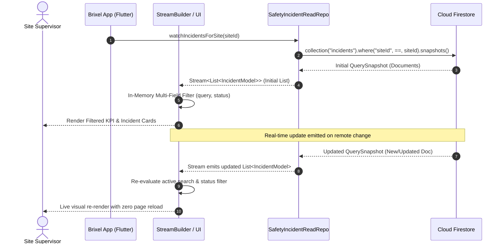
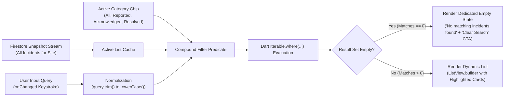
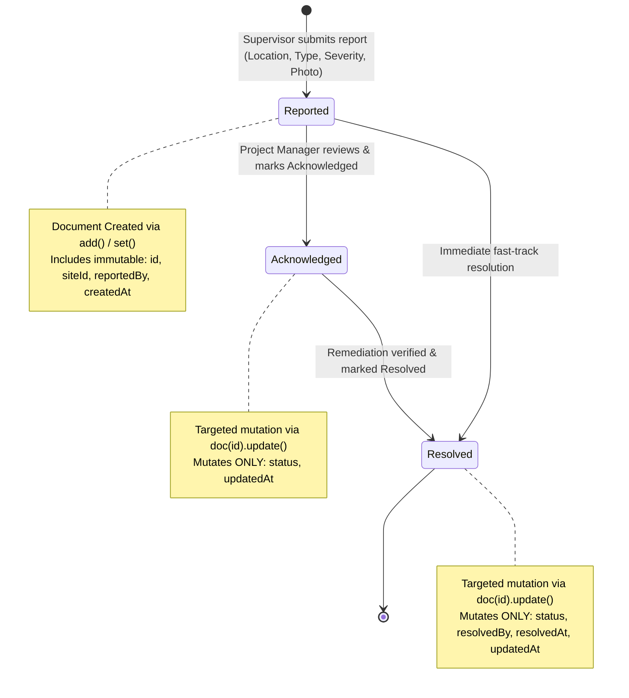
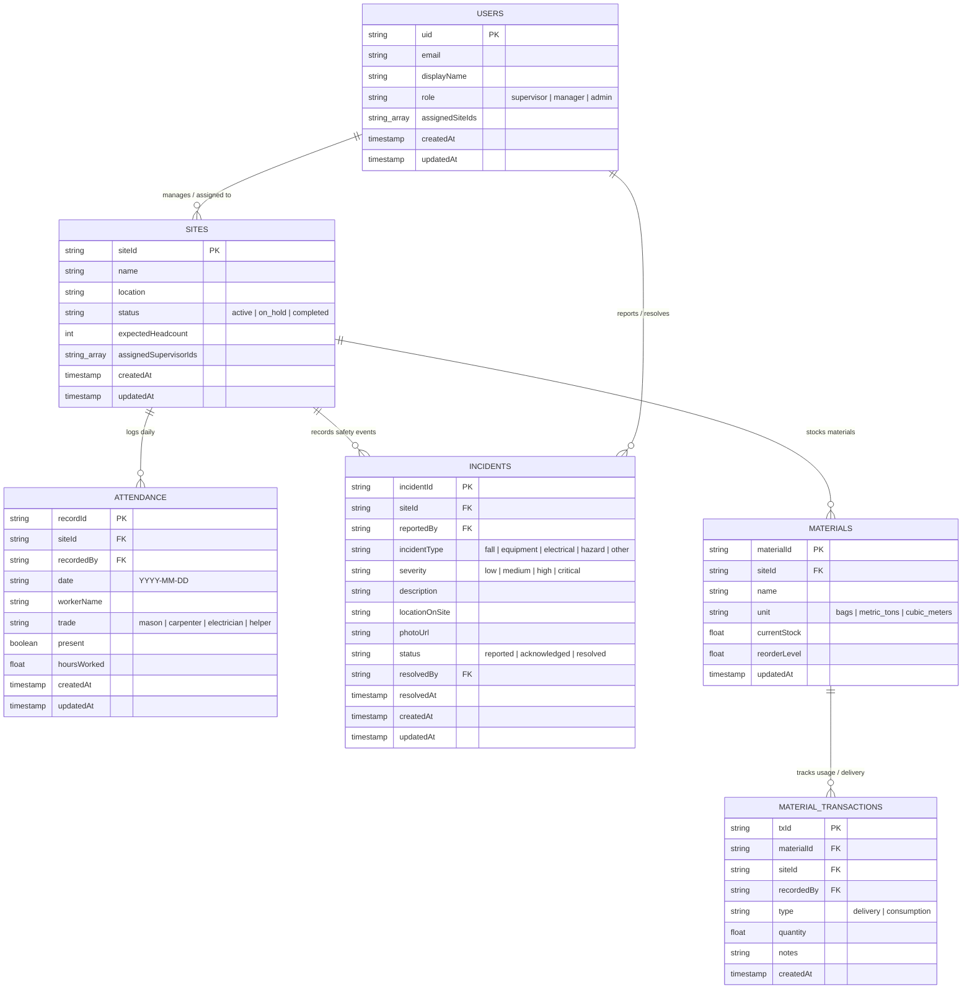
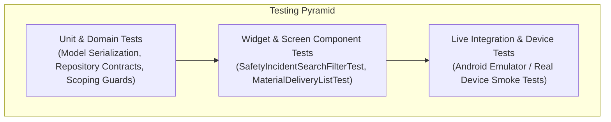

# High-Level Design (HLD) Document
## Brixel — Construction Site Operations & Real-Time Monitoring Platform

---

### Document Control

| Attribute | Details |
| :--- | :--- |
| **System** | Brixel Mobile Application |
| **Document Type** | High-Level Design (HLD) Specification |
| **Target Platforms** | Android (Primary), iOS (Cross-Platform Flutter) |
| **Tech Stack** | Flutter 3.x, Dart 3.x, Cloud Firestore, Firebase Auth, Firebase Storage |
| **Audience** | Software Architects, Engineering Leads, Product Managers, Security Engineers |
| **Status** | Approved Architectural Baseline |

---

## 1. Executive Summary & System Objectives

### 1.1 Problem Statement
In multi-site construction operations, site supervisors traditionally document labor attendance, material logistics, and workplace safety incidents in physical logbooks or ad-hoc messaging groups. These logs are reviewed periodically during head-office site visits. 

This operational lag introduces severe business risks:
- **Labor Misallocation:** Headcount discrepancies and contractor shortages are detected late, generating budget overruns or milestone delays.
- **Supply Disruptions:** Material depletion is uncovered only when physical work halts, while over-ordering ties up working capital.
- **Safety Governance Gaps:** High-severity safety hazards and compliance violations remain localized for days before head-office safety officers can intervene.

### 1.2 System Vision & Design Goals
Brixel is an enterprise mobile platform designed to bridge the operational divide between remote construction sites and centralized management. 

Key design objectives include:
1. **Minute-Latency Operational Visibility:** Real-time synchronization of site events to project manager dashboards via reactive database streaming.
2. **Frictionless On-Site Capture:** Highly optimized mobile workflows enabling full daily attendance recording in under 2 minutes, even under harsh site conditions.
3. **Compound Search & Live Filtering:** In-memory, keystroke-level filtering over streamed datasets, allowing instantaneous discovery of incidents, logs, and materials across sites without high-latency query overhead.
4. **Guaranteed Data Integrity:** Targeted atomic field mutations ensuring historical event metadata (creation timestamps, reporter identities) remains immutable.
5. **Offline Fault Tolerance:** Native client persistence ensuring continuous data entry in areas with intermittent cellular connectivity.

---

## 2. High-Level Architecture & Layered Design

Brixel follows a **Feature-Driven, Clean Layered Architecture**. The application cleanly separates UI presentation, domain business rules, and remote data persistence through contract-driven repository interfaces.

```mermaid
flowchart TD
    subgraph PresentationLayer["Presentation Layer (Flutter)"]
        UI_Screens["Feature Screens & Dashboards\n(SiteDashboard, SafetyIncidentList, MaterialDeliveryList)"]
        UI_Controllers["State & Form Controllers\n(TextEditingController, StreamBuilder, StatefulWidgets)"]
        UI_Components["Brixel Shared Design System\n(MetricCard, WorkerCard, ActionButtons)"]
    end

    subgraph DomainLayer["Domain & Service Layer"]
        Domain_Services["Feature Services\n(AttendanceService, SiteScopeGuard, AsyncRetry)"]
        Domain_Models["Immutable Domain Models\n(SiteModel, IncidentModel, DeliveryModel, UserModel)"]
        Repo_Interfaces["Repository Contracts\n(SafetyIncidentReadRepo, SafetyIncidentWriteRepo, SiteRepo)"]
    end

    subgraph DataLayer["Data & Persistence Layer"]
        Repo_Impls["Firestore Repository Implementations\n(FirestoreSafetyIncidentReadRepository, etc.)"]
        Storage_Service["Firebase Storage Adapters\n(FirebaseSafetyEvidenceStorage)"]
        Core_Firestore["Centralized Database Service\n(FirestoreDatabaseService)"]
    end

    subgraph InfrastructureLayer["Infrastructure & Cloud (Firebase)"]
        Cloud_Firestore[("Cloud Firestore\n(NoSQL Real-Time Database)")]
        Firebase_Auth["Firebase Authentication\n(Identity & JWT Claims)"]
        Firebase_Storage["Cloud Storage\n(Incident Media & Documents)"]
    end

    UI_Screens --> UI_Controllers
    UI_Screens --> UI_Components
    UI_Controllers --> Domain_Services
    UI_Controllers --> Repo_Interfaces
    Domain_Services --> Repo_Interfaces
    Repo_Interfaces <|.. Repo_Impls
    Repo_Impls --> Core_Firestore
    Storage_Service --> Core_Firestore
    Core_Firestore --> Cloud_Firestore
    Domain_Services --> Firebase_Auth
    Storage_Service --> Firebase_Storage
```

### 2.1 Layer Responsibilities

#### Presentation Layer
- **Responsibility:** Rendering the graphical user interface, capturing touch events, managing screen transitions, and reflecting reactive state streams.
- **Key Constructs:** `StreamBuilder<T>`, `StatefulWidget`, `TextEditingController`, and reusable UI components located in `lib/shared/widgets/`.
- **Design Rule:** Presentation widgets contain zero direct database queries; they interface exclusively through domain contracts and stateful streams.

#### Domain Layer
- **Responsibility:** Encapsulating enterprise business logic, model serialization/deserialization, input validation, role-based screen guards, and repository contracts.
- **Key Constructs:** `IncidentModel`, `SiteModel`, abstract repository interfaces, and utilities like `site_scope_guard.dart`.
- **Design Rule:** Completely decoupled from external SDK packages (pure Dart logic where possible).

#### Data Layer
- **Responsibility:** Concrete implementations of repository interfaces, handling Firestore document mapping, query assembly, photo upload payloads, error translation, and retry policies.
- **Key Constructs:** `FirestoreSafetyIncidentReadRepository`, `FirestoreSafetyIncidentWriteRepository`.

#### Infrastructure Layer
- **Responsibility:** Cloud-managed services powering authentication, persistent NoSQL document storage, object storage, and real-time push subscriptions.

---

## 3. Subsystem Architecture

### 3.1 Real-Time Streaming & State Synchronization Subsystem
The core responsiveness of Brixel relies on active document snapshot streaming directly to the client.



### 3.2 Live Search & Filtering Engine
To satisfy instant responsiveness requirements without incurring high Cloud Firestore read costs or query latency, the system utilizes a **Client-Side In-Memory Filtering Engine over Streamed Snapshots**.



#### Evaluation Rules:
1. **Multi-Field Matching:** The query string is tested against multiple document dimensions case-insensitively:
   - `incident.description.toLowerCase().contains(normalizedQuery)`
   - `incident.incidentType.toLowerCase().contains(normalizedQuery)`
   - `incident.id.toLowerCase().contains(normalizedQuery)`
   - `incident.severity.toLowerCase().contains(normalizedQuery)`
2. **Compound Filter Stacking:** Text filtering is evaluated in tandem with the selected `IncidentFilter` enum chip (`all`, `reported`, `acknowledged`, `resolved`).
3. **Zero Keystroke Network Overhead:** Because filtering occurs over the in-memory streamed list, typing emits zero Firestore network queries, guaranteeing sub-16ms frame performance and zero billable read amplification.

### 3.3 Safety Incident Lifecycle & Targeted Mutations
The incident management workflow supports strict role separation and auditable status transitions.



#### Targeted Mutation Strategy (`update()` vs. `set()`):
- **Safety Guarantee:** Calling `update()` directly mutates only `status`, `resolvedBy`, and `resolvedAt`. The original creation metadata (`createdAt`, `reportedBy`, `incidentType`, `photoUrl`) remains untouched.
- **Fail-Safe Protection:** If a document is deleted remotely or targeted with an invalid identifier, `update()` throws a `NOT_FOUND` error rather than accidentally creating an incomplete or corrupted ghost record.

---

## 4. Cloud Firestore Schema & Entity Relationships

The database architecture employs **Root-Level Collections linked via Foreign Keys (`siteId`, `uid`)**, optimizing for cross-site manager dashboards while allowing targeted single-site indexed subscriptions.



---

## 5. Security Architecture & Access Control

### 5.1 Role-Based Access Control (RBAC) Matrix

| Resource / Action | Site Supervisor | Project Manager | Safety Officer | System Admin |
| :--- | :---: | :---: | :---: | :---: |
| **View Assigned Sites** | Read Only | Read Only | Read Only | Full Access |
| **View Unassigned Sites** | Denied | Read Only | Read Only | Full Access |
| **Create Attendance Logs** | Write (Assigned Sites) | Denied | Denied | Full Access |
| **Create Incident Report** | Write (Assigned Sites) | Write (All Sites) | Denied | Full Access |
| **Acknowledge / Resolve Incident**| Denied | Write (All Sites) | Write (All Sites) | Full Access |
| **Delete Incident Record** | Denied | Denied | Denied | Full Access |
| **Log Material Consumption** | Write (Assigned Sites) | Denied | Denied | Full Access |

### 5.2 Firestore Security Rules Enforcement
Security is enforced at the database layer using Cloud Firestore Security Rules:
- **Identity Verification:** Requests require `request.auth != null`.
- **Site Boundary Guard:** Supervisors can only read/write documents where `request.resource.data.siteId in get(/databases/$(database)/documents/users/$(request.auth.uid)).data.assignedSiteIds`.
- **Targeted Immutability:** Write rules forbid modifications to `reportedBy`, `createdAt`, and `siteId` on existing incident documents during update operations.

---

## 6. Cross-Cutting Concerns & Non-Functional Attributes

### 6.1 Offline Resilience & Sync
1. **Firestore Local Cache:** Cloud Firestore offline persistence is enabled by default across mobile runtimes. Writes performed during complete network outages are queued locally and automatically committed upon signal restoration.
2. **Optimistic UI Updates:** Incident status chips and search operations evaluate the current local state cache instantly, preventing network latency from blocking on-site supervisors.

### 6.2 Performance & Battery Optimization
1. **In-Memory Query Evaluation:** High-frequency keystroke filtering runs entirely in memory without triggering network roundtrips.
2. **List Virtualization:** Incident, attendance, and delivery listings leverage `ListView.builder` for dynamic viewport recycling, keeping memory utilization flat regardless of list length.
3. **Asset Handling:** Photographic evidence uploaded from mobile devices is compressed on the client before transmission to Firebase Storage.

### 6.3 Fault Tolerance & User Feedback
- **Deterministic Cleanup:** Asynchronous calls and controllers utilize `try ... finally` blocks to ensure loading indicators are invariably dismissed, preventing frozen UI controls.
- **Visual Feedback:** All state mutations trigger contextual `SnackBar` notifications (confirming updates, flagging permission errors, or indicating offline queuing).

---

## 7. Verification & Quality Assurance Strategy

Brixel enforces a three-tiered testing strategy with strict code quality gates:



### 7.1 Quality Metrics & Standards
- **Automated Regression Suite:** 100% of core domain and feature suites passing (currently 183 automated tests).
- **Static Analysis:** Zero analyzer issues enforced via `dart analyze`.
- **UI State Coverage:** Every list screen must provide automated test coverage for:
  1. Data loading state (Progress indicator rendering).
  2. Active data population (`ListView.builder` item binding).
  3. Live interactive search & compound filter evaluation.
  4. Empty / zero-match recovery state (`"No matching incidents found"` + reset CTA).
  5. Network / authorization error state with retry actions.

---

## 8. Architectural Decision Records (ADRs)

### ADR-01: In-Memory Client Filtering vs. Firestore Server-Side Querying
- **Context:** Providing live search across incident reports as the user types.
- **Decision:** Stream all site incidents into client memory using `StreamBuilder` and apply Dart `Iterable.where(...)` filtering on each keystroke.
- **Rationale:** 
  - Firestore does not offer native full-text free search (e.g. `contains`).
  - Firing a Firestore query on every keystroke would incur massive billing costs and perceptible UI lag.
  - Typical single-site incident counts are well within client memory thresholds (< 2,000 active records per site).

### ADR-02: Flat Collection Hierarchy Linked by `siteId`
- **Context:** Choosing between root-level collections vs. nested subcollections (`sites/{siteId}/incidents/{id}`).
- **Decision:** Employ flat, root-level collections linked by a `siteId` foreign key.
- **Rationale:** 
  - Project managers require cross-site aggregation dashboards (e.g. critical incidents across all sites).
  - Flat collections allow direct indexed multi-site queries without requiring complex collection group queries or composite index proliferation.

### ADR-03: Targeted Partial Updates via `update()`
- **Context:** Changing incident lifecycle states (`reported` $\rightarrow$ `acknowledged` $\rightarrow$ `resolved`).
- **Decision:** Exclusively utilize `DocumentReference.update({...})` for status transitions.
- **Rationale:** Eliminates the risk of document overwrites associated with `set()`, ensuring creation audit trails remain strictly immutable.
