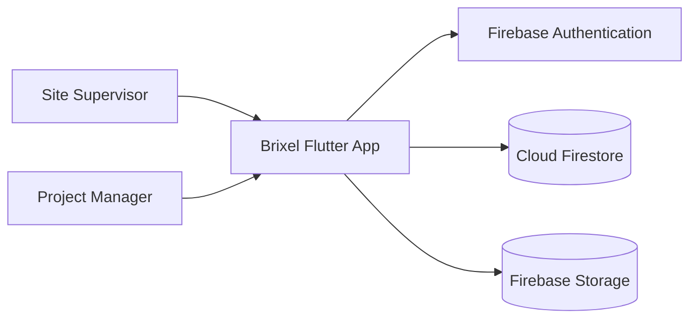
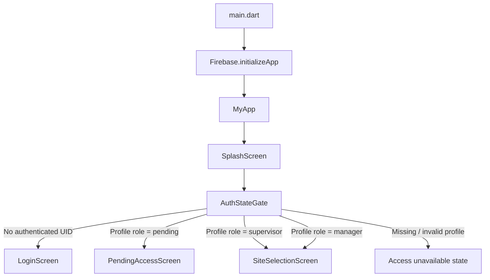
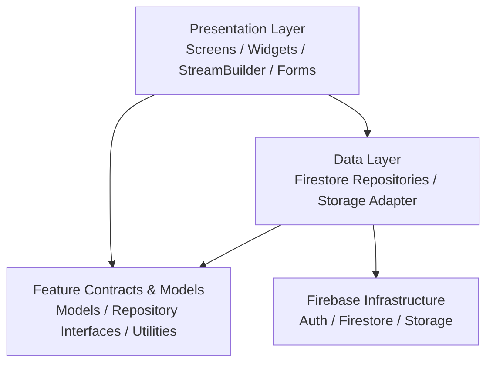
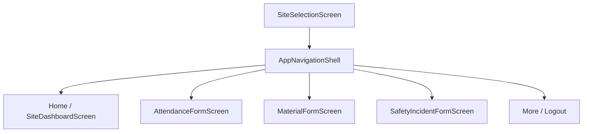
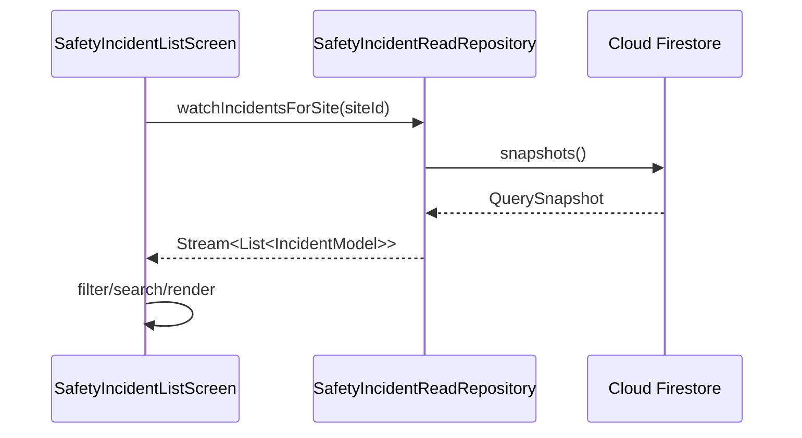
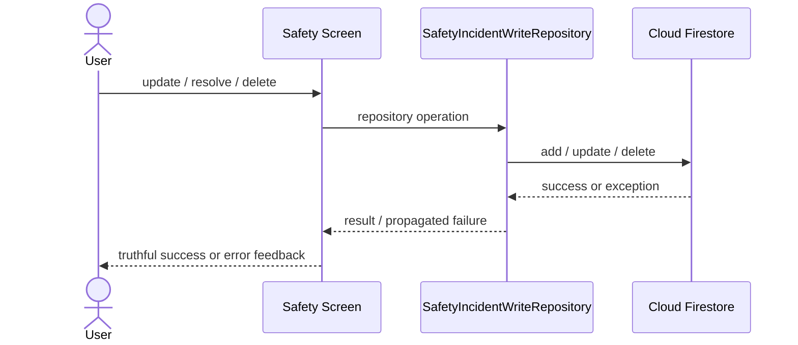
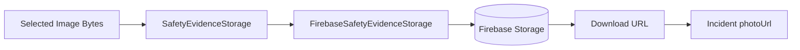
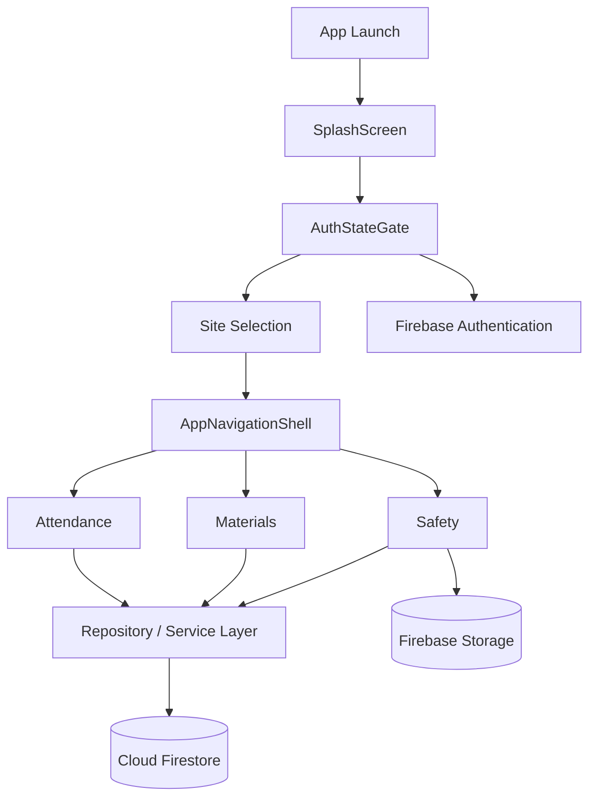

# Brixel Architecture

## 1. Purpose

This document describes the current application architecture of **Brixel**, a Flutter + Firebase mobile application for construction-site reporting.

Brixel is designed to reduce the delay between what happens at a construction site and what project managers can see. The current product flow focuses on:

- authentication and role-aware access
- site selection
- attendance reporting
- material usage reporting
- safety incident reporting
- safety evidence upload
- real-time safety updates
- user feedback, loading, error, and retry behavior

This file is an implementation-facing overview. Detailed product requirements are documented in `docs/PRD_Brixel.md`, high-level design decisions in `docs/HLD_Brixel.md`, Firestore structure in `docs/architecture/firestore_schema.md`, and folder conventions in `docs/architecture/project_structure.md`.

---

## 2. Architectural Style

Brixel uses a **feature-first, layered Flutter architecture**.

The codebase is organized primarily by product feature instead of placing all screens, models, or services into global type-based folders. Shared application-wide concerns live in `core/`, while reusable UI components live in `shared/`.

The main architectural goals are:

1. keep feature code together
2. separate UI concerns from Firebase access where practical
3. use repository/service abstractions around external systems
4. keep authentication separate from authorization
5. preserve site context across navigation
6. fail safely when access or remote operations cannot be verified
7. keep code testable through dependency injection and fake implementations

---

## 3. System Context



Brixel is a Flutter client application. Firebase provides the main cloud infrastructure:

- **Firebase Authentication** identifies the signed-in user.
- **Cloud Firestore** stores structured application records and user profiles.
- **Firebase Storage** stores safety evidence files such as incident images.
- **Firestore Security Rules** enforce database-side access controls.

---

## 4. Application Startup and Routing

The current startup flow is:



### `main.dart`

`main.dart` is responsible for:

- Flutter binding initialization
- Firebase initialization
- constructing `MyApp`
- registering top-level routes
- applying the Brixel theme

Feature business logic should not live in `main.dart`.

### `SplashScreen`

`SplashScreen` provides a short branded startup state and then replaces itself with `AuthStateGate`.

It does **not** decide whether the user is authenticated or what role they have.

### `AuthStateGate`

`AuthStateGate` is the central session/access routing boundary.

It:

1. watches the current Firebase Authentication UID
2. loads the corresponding Firestore user profile
3. checks the application role
4. routes to the correct access state

Current handled roles are:

- `pending`
- `supervisor`
- `manager`

Unsupported roles and missing profiles fail closed instead of granting access.

Top-level routes such as `/login` and `/sites` are also routed through the session gate so navigation cannot bypass authentication state handling.

---

## 5. Feature-First Project Structure

```text
lib/
├── main.dart
├── firebase_options.dart
│
├── core/
│   ├── services/
│   ├── theme/
│   └── utils/
│
├── features/
│   ├── auth/
│   ├── attendance/
│   ├── materials/
│   ├── navigation/
│   ├── safety/
│   ├── sites/
│   └── splash/
│
└── shared/
    └── widgets/
```

### `core/`

Contains application-wide technical concerns.

Examples:

- `FirestoreDatabaseService`
- Brixel theme and colors
- `SiteScopeGuard`
- async retry utilities

### `features/`

Contains feature-owned code.

Each feature may contain its own:

- screens
- models
- repositories
- services
- widgets
- storage adapters

### `shared/`

Contains UI components that are genuinely reused across multiple features, such as shared Brixel cards, buttons, and metrics.

---

## 6. Layered Design



Brixel does not use a separate external state-management framework. Current state is handled mainly through Flutter mechanisms such as:

- `StatefulWidget`
- `setState()`
- `StreamBuilder`
- `TextEditingController`
- `IndexedStack`

### Presentation Layer

Responsible for:

- forms and validation
- rendering loading, success, empty, and error states
- navigation
- SnackBar and Dialog feedback
- listening to repository streams

### Models and Contracts

Feature models define structured application data, while repository/service interfaces define what a feature needs without forcing UI code to depend directly on Firebase SDK details.

### Data Layer

Concrete implementations communicate with Firebase.

Examples include:

- Firestore user repositories
- safety incident read/write repositories
- material usage repositories
- `FirebaseSafetyEvidenceStorage`

### Infrastructure Layer

Firebase SDKs provide authentication, Firestore persistence, and file storage.

---

## 7. Navigation Architecture

After a site is selected, Brixel uses `AppNavigationShell` to keep the selected site context available while switching between core modules.



`AppNavigationShell` uses:

- `BottomNavigationBar` for module switching
- `IndexedStack` to preserve tab state while switching between screens

This prevents form input and local screen state from being unnecessarily rebuilt every time the user changes tabs.

---

## 8. Authentication vs Authorization

Brixel deliberately separates **authentication** from **authorization**.

### Authentication

Firebase Authentication answers:

> Who is the user?

`FirebaseAuthService` exposes authentication operations and authentication-state changes.

### Authorization

The Firestore user profile answers:

> What access should this user have inside Brixel?

The user profile contains application data such as:

- role
- assigned site IDs
- display information

The registration flow does not treat a newly created account as a manager. New access can remain `pending` until a trusted process assigns appropriate role/site permissions.

Client-side routing is not treated as the only security boundary. Firestore Security Rules enforce database-side restrictions as well.

---

## 9. Firestore Data Architecture

The current Firestore architecture uses root-level collections linked by identifiers such as `siteId` and `uid`.

```text
Firestore
├── users/
├── sites/
├── attendance/
├── materials/
├── material_transactions/
└── incidents/
```

`FirestoreDatabaseService` centralizes references to these collections and provides common stream/query helpers.

### Why root-level collections?

Root-level collections make it possible to query records across sites while still filtering by `siteId` where needed.

For example:

```text
incidents
  where siteId == selectedSiteId
```

can drive a site-specific safety screen, while manager-oriented queries can operate over the same root collection.

Detailed field definitions are maintained in:

`docs/architecture/firestore_schema.md`

---

## 10. Safety Incident Data Flow

Safety is currently the most complete example of the layered architecture.

### Read flow



The UI can react to Firestore snapshot changes without manually reloading the page.

### Write flow



For retry-safe mutations, temporary failures can use bounded retry handling. Final failures propagate to the UI so local state does not pretend a remote operation succeeded.

Incident creation is not blindly retried because a non-idempotent create operation could produce duplicate records.

---

## 11. Safety Evidence Storage

Safety evidence files are stored separately from structured Firestore records.



The storage path is scoped by site and incident:

```text
sites/{siteId}/safety/{incidentId}/evidence/{fileName}
```

This keeps evidence grouped by the record it belongs to instead of using one flat file namespace.

The Storage service validates:

- site ID
- incident ID
- file name
- content type
- non-empty file bytes

---

## 12. Error Handling and User Feedback

Brixel separates failure handling into two concerns:

### Error handling

Repositories and utilities determine whether an operation can recover or must fail.

Temporary failures may be retried with bounded attempts. Permanent failures are propagated rather than hidden.

### User feedback

Screens communicate the outcome in user-facing language.

Examples:

- loading indicators during async work
- safe SnackBars for success/failure
- confirmation Dialog before destructive deletion
- disabled submit controls during in-flight operations

Raw internal exception text should not be shown directly to users.

---

## 13. Firestore Security Architecture

`firestore.rules` provides database-side authorization.

Current rule concepts include:

- authenticated-access checks
- role checks using user profiles/custom claims
- pending-only self-registration constraints
- protection against self-assigning manager/supervisor privileges
- immutable audit fields during updates
- manager/supervisor restrictions for sensitive mutations
- default deny for unmatched paths

### Security boundary rule

UI visibility is not security.

Hiding a button or preventing navigation does not replace Firestore Security Rules.

### Current security gap to track

The current `sites/{siteId}` read rule permits any authenticated user to read site documents. That is broader than the product requirement that supervisors should only access assigned/permitted sites.

The final production rules should align site reads with the approved site-assignment model.

Also, the repository currently contains Firestore rules but does not contain a tracked `storage.rules` file. Firebase Storage authorization should therefore be treated as a production-hardening requirement before evidence uploads are considered fully secured.

---

## 14. Testing and Testability

The architecture deliberately supports dependency injection so Firebase-dependent behavior can be tested without requiring live Firebase access in every widget test.

Examples:

- `AuthStateGate` accepts authentication/profile dependencies and destination builders.
- `SplashScreen` accepts a configurable duration and destination builder.
- repositories can be replaced with fake implementations in tests.
- `FirebaseSafetyEvidenceStorage` accepts an injectable `FirebaseStorage` instance.

Testing is organized across:

1. **Unit tests** — validation, models, retry helpers, guards
2. **Widget tests** — forms, dialogs, navigation, loading/error states
3. **Repository/data tests** — read/write behavior and contracts
4. **Security rule tests** — Firestore authorization behavior
5. **Integration-oriented widget flows** — site selection, navigation, auth-state routing, and startup handoff

The normal quality gate is:

```text
flutter analyze
flutter test
git diff --check
```

---

## 15. Current Architectural Boundaries and Known Limitations

This document describes what is implemented or directly supported by the current repository. The following boundaries should remain explicit:

1. **Manager and supervisor default routing currently converge on `SiteSelectionScreen`.** A dedicated manager dashboard is not the default destination in `AuthStateGate` yet.
2. **Assigned-site authorization is not fully enforced by current Firestore site-read rules.** Client routing alone must not be treated as sufficient access control.
3. **Firebase Storage security rules are not currently tracked in the repository.** Evidence upload authorization requires further hardening.
4. **Material reporting in the Sprint MVP is centered on material usage/reporting.** Broader inventory, low-stock, purchasing, or procurement behavior described in older design material should not be assumed to be active MVP scope without an explicit product decision.
5. **No guarantee of reliable offline submission is made by this architecture document.** Any offline behavior must be separately validated before being treated as a product capability.
6. **The app currently uses Flutter-native state mechanisms rather than a dedicated state-management package.** Introducing Provider, Riverpod, Bloc, or another framework would require a reviewed architecture decision.

---

## 16. Related Architecture Documents

- `docs/PRD_Brixel.md` — product requirements and scope
- `docs/HLD_Brixel.md` — high-level system design
- `docs/architecture/project_structure.md` — folder ownership and structure rules
- `docs/architecture/firestore_schema.md` — Firestore collections and field-level schema
- `docs/ux/flows.md` — user journeys and UI states
- `firestore.rules` — database authorization rules

---

## 17. Architecture Summary



The central architectural idea is simple:

> **Flutter screens manage presentation and interaction, feature contracts/models define application behavior, repository/service implementations isolate Firebase access, and Firebase Security Rules remain the final database-side access boundary.**
