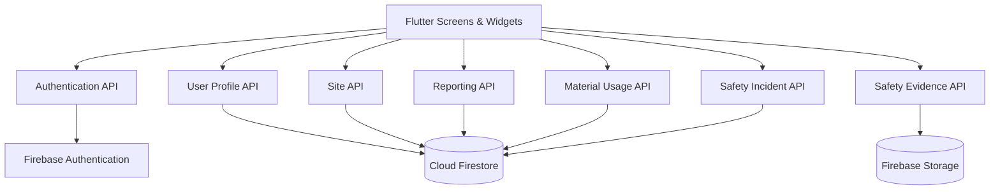
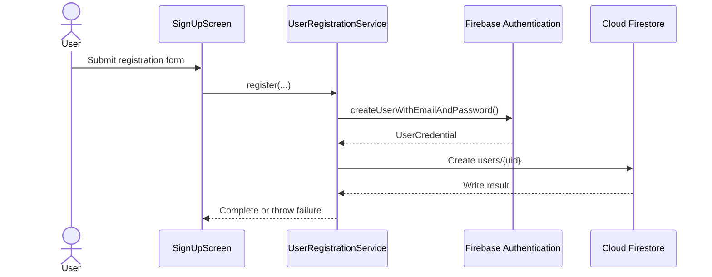

# Brixel API Structure

## 1. Purpose

This document describes the API boundaries used by **Brixel**, a Flutter + Firebase construction-site reporting application.

Brixel does not currently expose a custom REST or HTTP backend API.

Instead, the Flutter application communicates with Firebase through strongly typed Dart service and repository interfaces.

The main API flow is:

```text
Flutter Screen
      ↓
Service / Repository Contract
      ↓
Firebase Implementation
      ↓
Firebase Authentication / Firestore / Storage
```

This structure keeps Firebase-specific implementation details separate from most UI code and makes the application easier to test using fake implementations.

---

## 2. API Architecture



The API layer is divided by responsibility instead of using one large Firebase service.

---

## 3. Authentication API

### Service

```text
FirebaseAuthService
```

Location:

```text
lib/features/auth/services/firebase_auth_service.dart
```

The authentication API is responsible for Firebase Authentication operations.

### Available operations

| Operation | Return Type | Purpose |
|---|---|---|
| `currentUser` | `User?` | Returns the currently authenticated Firebase user |
| `watchUserId()` | `Stream<String?>` | Watches authentication-state changes |
| `signUp()` | `Future<UserCredential>` | Creates a Firebase Authentication account |
| `signIn()` | `Future<UserCredential>` | Signs an existing user in |
| `signOut()` | `Future<void>` | Ends the current Firebase session |

### Sign-in flow

```text
LoginScreen
    ↓
FirebaseAuthService.signIn()
    ↓
Firebase Authentication
    ↓
authStateChanges()
    ↓
AuthStateGate
```

The login screen does not decide which protected screen the user receives.

After authentication succeeds, `AuthStateGate` reacts to the authentication stream and checks the user's Firestore profile.

---

## 4. Registration API

### Service

```text
UserRegistrationService
```

Location:

```text
lib/features/auth/services/user_registration_service.dart
```

### Main operation

```dart
register({
  required String displayName,
  required String email,
  required String password,
})
```

### Registration flow



A newly registered Brixel account is created with:

```text
role: pending
assignedSiteIds: []
```

Registration does not automatically grant supervisor or manager privileges.

---

## 5. User Profile API

### Contract

```text
UserRepository
```

Location:

```text
lib/features/auth/repositories/user_repository.dart
```

### Concrete implementation

```text
FirestoreUserRepository
```

### API

```dart
Stream<UserModel?> watchUserProfile(String uid);
```

This API observes:

```text
users/{uid}
```

and converts the Firestore document into a `UserModel`.

The user profile provides application-level authorization information such as:

- display name
- email
- role
- assigned site IDs

### Authentication vs authorization

Firebase Authentication answers:

```text
Who is the user?
```

The Firestore user profile answers:

```text
What is this user allowed to access?
```

`AuthStateGate` combines these two APIs before granting application access.

---

## 6. Site API

### Contract

```text
SiteRepository
```

Location:

```text
lib/features/sites/repositories/site_repository.dart
```

### Implementation

```text
FirestoreSiteRepository
```

### Operations

```dart
Stream<List<SiteModel>> watchAllSites();

Stream<List<SiteModel>> watchAssignedSites(
  List<String> siteIds,
);

Stream<List<SiteModel>> watchSitesForSupervisor(
  String supervisorId,
);
```

### Purpose

These APIs provide real-time site streams.

For supervisors, the application can request only their assigned site IDs.

Firestore Security Rules remain the backend access boundary and should not be replaced by client-side filtering.

---

## 7. Site Report API

Brixel provides a shared site-scoped reporting repository for the main reporting workflow.

### Repository

```text
SiteReportRepository
```

Location:

```text
lib/features/reporting/repositories/site_report_repository.dart
```

### Attendance operation

```dart
Future<void> saveAttendance(
  String siteId,
  Map<String, dynamic> data,
);
```

Before writing, the repository verifies:

- a site has been selected
- an authenticated user exists
- hours are finite
- hours are between 0 and 24
- absent workers have zero hours
- present workers have positive hours

The final Firestore payload includes:

```text
siteId
recordedBy
date
createdAt
updatedAt
```

Server timestamps are used for persisted timestamps.

---

## 8. Material Reporting API

### Shared site-report operation

```dart
Future<void> saveMaterial(
  String siteId,
  Map<String, dynamic> data,
);
```

The repository validates:

- authenticated author
- active site
- positive finite quantity

It delegates the Firestore write to the material usage repository.

---

## 9. Material Usage API

### Read contract

```text
MaterialUsageReadRepository
```

API:

```dart
Future<List<MaterialTransactionModel>>
fetchUsageForSite(String siteId);
```

Implementation:

```text
FirestoreMaterialUsageReadRepository
```

The Firestore query filters:

```text
material_transactions
where siteId == selected site
where type == "used"
```

---

### Write contract

```text
MaterialUsageWriteRepository
```

API:

```dart
Future<String> addUsage({
  required String activeSiteId,
  required MaterialTransactionModel usage,
});
```

Implementation:

```text
FirestoreMaterialUsageWriteRepository
```

The write API verifies:

- the record belongs to the active site
- transaction type is `used`
- quantity is positive and finite
- an author is present

The persisted timestamp uses:

```dart
FieldValue.serverTimestamp()
```

---

## 10. Generic Report Stream API

`SiteReportRepository` also provides:

```dart
Stream<List<Map<String, dynamic>>> watch(
  String siteId,
  String collection,
);
```

Currently supported report collections are:

```text
attendance
incidents
material_transactions
```

The query always includes:

```text
where siteId == selectedSiteId
```

This prevents report history from mixing records from different sites at the application-query level.

Backend authorization is additionally enforced by Firebase Security Rules.

---

## 11. Safety Incident Read API

### Contract

```text
SafetyIncidentReadRepository
```

### Implementation

```text
FirestoreSafetyIncidentReadRepository
```

### One-time fetch

```dart
Future<List<IncidentModel>>
fetchIncidentsForSite(String siteId);
```

### Real-time stream

```dart
Stream<List<IncidentModel>>
watchIncidentsForSite(String siteId);
```

The real-time API uses Firestore snapshots:

```text
incidents
where siteId == selectedSiteId
      ↓
snapshots()
      ↓
Stream<List<IncidentModel>>
      ↓
SafetyIncidentListScreen
```

This allows incident lists to react when matching Firestore documents change.

---

## 12. Safety Incident Write API

### Contract

```text
SafetyIncidentWriteRepository
```

### Implementation

```text
FirestoreSafetyIncidentWriteRepository
```

### Create document ID

```dart
String createIncidentId();
```

This is useful when an incident ID is needed before uploading evidence.

---

### Create incident

```dart
Future<String> addIncident({
  required String activeSiteId,
  required IncidentModel incident,
});
```

The repository validates:

- active site matches the incident site
- reporter ID is present
- initial incident status is `reported`

The create operation is deliberately not blindly retried.

An uncertain retry of a non-idempotent create operation could result in duplicate records.

---

### Update status

```dart
Future<void> updateIncidentStatus({
  required String incidentId,
  required String status,
  String? resolvedBy,
});
```

Supported statuses:

```text
reported
acknowledged
resolved
```

When an incident is resolved, resolution metadata is updated using server timestamps.

---

### Update fields

```dart
Future<void> updateIncidentFields({
  required String incidentId,
  required Map<String, dynamic> fields,
});
```

The repository prevents mutation of fields such as:

```text
id
siteId
createdAt
reportedBy
```

These represent record identity or audit information.

---

### Delete incident

```dart
Future<void> deleteIncident({
  required String incidentId,
});
```

The UI requires deletion confirmation before this operation is called.

Firebase Security Rules determine whether the authenticated user is actually allowed to delete the record.

---

## 13. Retry API

Temporary Firestore failures for selected update/delete operations use the shared utility:

```text
runWithRetry()
```

Location:

```text
lib/core/utils/async_retry.dart
```

Retryable failures include:

```text
TimeoutException

Firebase:
aborted
deadline-exceeded
resource-exhausted
unavailable
```

Permanent failures are propagated instead of repeatedly retried.

---

## 14. Firebase Storage API

### Contract

```text
SafetyEvidenceStorage
```

Location:

```text
lib/features/safety/storage/safety_evidence_storage.dart
```

### Implementation

```text
FirebaseSafetyEvidenceStorage
```

### API

```dart
Future<String> uploadEvidence({
  required String siteId,
  required String incidentId,
  required String fileName,
  required Uint8List bytes,
  required String contentType,
});
```

The returned string is the Firebase Storage download URL.

### Storage path

```text
sites/{siteId}/safety/{incidentId}/evidence/{fileName}
```

### Validation

The implementation checks:

- valid site ID
- valid incident ID
- valid filename
- non-empty bytes
- maximum size of 10 MB
- supported image content type

Supported types include:

```text
image/jpeg
image/png
image/webp
image/gif
image/heic
image/heif
```

---

## 15. Firestore Database Service

The common Firestore adapter is:

```text
FirestoreDatabaseService
```

Location:

```text
lib/core/services/firestore_database_service.dart
```

It centralizes collection references:

```text
users
sites
attendance
materials
material_transactions
incidents
```

It also provides shared query/write helpers used by feature repositories.

Example operations include:

```text
streamUserProfile()
streamAllSites()
streamAssignedSites()
streamSitesForSupervisor()
streamDailyAttendance()
streamPresentAttendance()
streamLowStockMaterials()
streamHighSeverityIncidents()
streamIncidentsForSite()
addAttendanceReport()
addMaterialTransaction()
```

Feature screens should prefer repository/service APIs instead of duplicating Firestore query logic.

---

## 16. Firestore API Mapping

| Brixel operation | Firebase resource |
|---|---|
| Register account | Firebase Authentication + `users/{uid}` |
| Sign in/out | Firebase Authentication |
| Watch profile | `users/{uid}` |
| Watch sites | `sites` |
| Save attendance | `attendance/{generatedId}` |
| Read attendance history | `attendance` filtered by `siteId` |
| Save material usage | `material_transactions/{generatedId}` |
| Read material usage | `material_transactions` filtered by `siteId` and `type` |
| Create safety incident | `incidents/{incidentId}` |
| Watch safety incidents | `incidents` filtered by `siteId` |
| Update incident | `incidents/{incidentId}` |
| Delete incident | `incidents/{incidentId}` |
| Upload safety evidence | Firebase Storage site/incident path |

---

## 17. Security Boundary

Brixel uses two layers of access control.

### Client layer

The application checks:

- Firebase authentication state
- Firestore profile role
- assigned site IDs
- current selected site

### Firebase layer

Firestore and Storage Security Rules independently validate backend access.

The general security flow is:

```text
User Action
    ↓
Flutter validation
    ↓
Repository/service validation
    ↓
Firebase request
    ↓
Security Rules
    ↓
Allow / Deny
```

Client-side validation improves user experience but is not treated as the final security boundary.

---

## 18. Error Handling Contract

Repository and service APIs follow these principles:

1. validate required arguments before making Firebase calls
2. await persistence before reporting success
3. throw failures back to the calling UI when the operation cannot complete
4. retry only selected temporary failures
5. do not expose raw Firebase exception details directly to users
6. keep loading state truthful using `try / catch / finally`

The UI converts technical failures into understandable user-facing messages.

---

## 19. Testability

Repository and service interfaces make Firebase-dependent code easier to test.

For example:

```text
Production:
Screen → FirestoreSafetyIncidentReadRepository → Firestore

Test:
Screen → FakeSafetyIncidentReadRepository
```

This allows widget and unit tests to verify behavior without requiring live Firebase for every test.

The same dependency-injection approach is used in authentication, repositories, storage, and startup behavior.

---

## 20. API Design Summary

Brixel does not use a traditional REST API layer.

Its application API consists of Dart contracts and Firebase-backed implementations.

The design can be summarized as:

```text
Presentation
     ↓
Feature API Contract
     ↓
Repository / Service Implementation
     ↓
Firebase SDK
     ↓
Firebase Authentication
Cloud Firestore
Firebase Storage
     ↓
Security Rules
```

The main architectural benefit is separation of responsibility:

- Flutter screens manage interaction and presentation.
- models define structured application data.
- repository/service contracts define operations.
- Firebase implementations handle persistence and authentication.
- Firebase Security Rules enforce backend authorization.

This keeps Brixel's reporting workflows site-scoped, testable, and easier to maintain.
