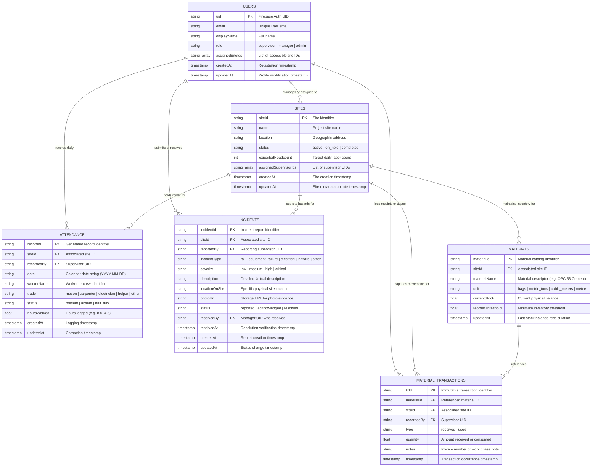

# Database Design Document
## Brixel — Cloud Firestore Data Architecture & Schema Specification

---

### Document Control

| Attribute | Details |
| :--- | :--- |
| **System** | Brixel Construction Site Management Platform |
| **Document Type** | Database Design & Schema Specification (`db_design.md`) |
| **Database Engine** | Cloud Firestore (Serverless Document NoSQL) |
| **Audience** | Backend Engineers, Mobile Developers, Data Architects, Security Engineers |
| **Status** | Approved Baseline Specification |

---

## 1. Executive Summary & Design Tenets

Brixel manages mission-critical daily construction site operations: labor attendance, material logistics, and workplace safety incidents across geographically dispersed sites. 

To satisfy the demanding operational environment—where site supervisors operate under poor cellular connectivity while central project managers require instant visibility across all active projects—the database architecture is built on **Cloud Firestore**.

### Core Database Design Tenets:
1. **Schema Consistency Across Documents:** Firestore is fundamentally schemaless. Strict structural uniformity, camelCase naming standards, and disciplined typing are enforced at the application layer via strongly typed Dart models and at the database layer via Firestore Security Rules.
2. **Read-Optimized Root Collections:** Data needed for cross-site executive dashboards (incident alerts, low-stock notifications) are organized into root-level collections linked via `siteId` foreign keys rather than deeply nested subcollections. This avoids the complexity and indexing overhead of collection-group queries.
3. **Auditable Server Timestamps:** Every mutating operation uses `FieldValue.serverTimestamp()` to ensure device clock discrepancies cannot corrupt chronological feeds.
4. **Separation of Mutation Concerns:** Read streams capture full document sets into local reactive state, while write operations utilize targeted `doc(id).update(...)` calls to mutate only permitted fields, guaranteeing the immutability of creation audit trails.
5. **Offline Resiliency:** Structure supports Firestore's offline persistence engine with client-side optimistic UI updates and deterministic background sync.

---

## 2. Collection Hierarchy & Entity Relationships

### 2.1 Collection Topology
```text
Cloud Firestore Root
├── users/ (Collection)
│   └── {uid} (Document)
├── sites/ (Collection)
│   └── {siteId} (Document)
├── attendance/ (Collection)
│   └── {recordId} (Document)
├── materials/ (Collection)
│   └── {materialId} (Document)
├── material_transactions/ (Collection)
│   └── {txId} (Document)
└── incidents/ (Collection)
    └── {incidentId} (Document)
```

### 2.2 Entity-Relationship Diagram (ERD)



---

## 3. Data Dictionary & Detailed Collection Schemas

### 3.1 Collection: `users`
Represents registered system users, authentication references, security roles, and site authorization assignments.

* **Collection Path:** `/users/{uid}`
* **Document ID:** Matches Firebase Auth User UID (`auth.uid`).

| Field Name | Firestore Data Type | Required | Default / Format | Description |
| :--- | :--- | :---: | :--- | :--- |
| `uid` | `string` | Yes | `auth.uid` | Unique Firebase Authentication UID |
| `email` | `string` | Yes | Standard email | Login and notification email address |
| `displayName` | `string` | Yes | Text string | User's full professional name |
| `role` | `string` | Yes | `'supervisor'` | User role: `'supervisor'`, `'manager'`, or `'admin'` |
| `assignedSiteIds`| `array<string>` | Yes | `[]` | Array of `siteId` strings the user is authorized to access |
| `createdAt` | `timestamp` | Yes | Server timestamp | Account provisioning date |
| `updatedAt` | `timestamp` | Yes | Server timestamp | Last profile or role update date |

**Sample Document (`users/usr_sup_101`):**
```json
{
  "uid": "usr_sup_101",
  "email": "meera.s@brixel.app",
  "displayName": "Meera Sundaram",
  "role": "supervisor",
  "assignedSiteIds": ["site-jaipur-01", "site-metro-line1"],
  "createdAt": "2026-10-01T04:00:00.000Z",
  "updatedAt": "2026-10-01T04:00:00.000Z"
}
```

---

### 3.2 Collection: `sites`
Maintains construction project profiles, site boundaries, and operational target headcounts.

* **Collection Path:** `/sites/{siteId}`
* **Document ID:** Slugified site identifier (e.g., `site-jaipur-01`).

| Field Name | Firestore Data Type | Required | Default / Format | Description |
| :--- | :--- | :---: | :--- | :--- |
| `siteId` | `string` | Yes | Slug format | Unique project site identifier |
| `name` | `string` | Yes | Text string | Project name (e.g., Jaipur Residential Project) |
| `location` | `string` | Yes | Text string | Physical geographic address |
| `status` | `string` | Yes | `'active'` | Project status: `'active'`, `'on_hold'`, `'completed'` |
| `expectedHeadcount`| `number (integer)` | Yes | `0` | Expected daily workforce for labor variance calculation |
| `assignedSupervisorIds` | `array<string>` | Yes | `[]` | Array of UIDs of supervisors assigned to this site |
| `createdAt` | `timestamp` | Yes | Server timestamp | Site creation timestamp |
| `updatedAt` | `timestamp` | Yes | Server timestamp | Last site modification timestamp |

**Sample Document (`sites/site-jaipur-01`):**
```json
{
  "siteId": "site-jaipur-01",
  "name": "Jaipur Residential Project",
  "location": "Jaipur, Rajasthan",
  "status": "active",
  "expectedHeadcount": 35,
  "assignedSupervisorIds": ["usr_sup_101"],
  "createdAt": "2026-10-01T04:00:00.000Z",
  "updatedAt": "2026-10-01T04:00:00.000Z"
}
```

---

### 3.3 Collection: `attendance`
Stores daily labor attendance records per worker or trade crew.

* **Collection Path:** `/attendance/{recordId}`
* **Document ID:** Auto-generated Firestore ID.

| Field Name | Firestore Data Type | Required | Default / Format | Description |
| :--- | :--- | :---: | :--- | :--- |
| `siteId` | `string` | Yes | Foreign Key (`sites.siteId`) | Associated site identifier |
| `workerName` | `string` | Yes | Text string | Individual worker name or crew identifier |
| `trade` | `string` | Yes | Trade descriptor | Craft category (e.g., Mason, Carpenter, Electrician, Helper) |
| `status` | `string` | Yes | `'present'` | Attendance status: `'present'`, `'absent'`, `'half_day'` |
| `hoursWorked`| `number (double)` | Yes | `8.0` | Number of hours worked during the shift |
| `date` | `string` | Yes | `YYYY-MM-DD` | Calendar date string formatted for fast composite querying |
| `recordedBy` | `string` | Yes | Foreign Key (`users.uid`) | UID of supervisor who recorded the entry |
| `createdAt` | `timestamp` | Yes | Server timestamp | Record submission timestamp |
| `updatedAt` | `timestamp` | Yes | Server timestamp | Last modification timestamp |

**Sample Document (`attendance/att_jaipur_001`):**
```json
{
  "siteId": "site-jaipur-01",
  "workerName": "Ramesh Kumar (Mason Crew Alpha)",
  "trade": "Mason",
  "status": "present",
  "hoursWorked": 8.0,
  "date": "2026-10-25",
  "recordedBy": "usr_sup_101",
  "createdAt": "2026-10-25T03:30:00.000Z",
  "updatedAt": "2026-10-25T03:30:00.000Z"
}
```

---

### 3.4 Collection: `materials`
Tracks stock levels, measurement units, and reorder threshold levels per site.

* **Collection Path:** `/materials/{materialId}`
* **Document ID:** Slug or auto-generated ID (e.g., `mat-cement-53`).

| Field Name | Firestore Data Type | Required | Default / Format | Description |
| :--- | :--- | :---: | :--- | :--- |
| `materialId` | `string` | Yes | Identifier string | Material record identifier |
| `siteId` | `string` | Yes | Foreign Key (`sites.siteId`) | Associated site identifier |
| `materialName`| `string` | Yes | Text string | Item name (e.g., OPC 53 Grade Cement, 12mm TMT Steel) |
| `unit` | `string` | Yes | Standardized unit | Unit of measure (`'bags'`, `'metric_tons'`, `'cubic_meters'`) |
| `currentStock`| `number (double)` | Yes | `0.0` | Real-time physical quantity available on site |
| `reorderThreshold` | `number (double)` | Yes | `0.0` | Minimum stock level triggering a low-stock alert |
| `updatedAt` | `timestamp` | Yes | Server timestamp | Timestamp of last stock balance change |

**Sample Document (`materials/mat-cement-53`):**
```json
{
  "materialId": "mat-cement-53",
  "siteId": "site-jaipur-01",
  "materialName": "OPC 53 Grade Cement",
  "unit": "bags",
  "currentStock": 75.0,
  "reorderThreshold": 100.0,
  "updatedAt": "2026-10-25T04:15:00.000Z"
}
```

---

### 3.5 Collection: `material_transactions`
An append-only, immutable audit ledger tracking every receipt and consumption event.

* **Collection Path:** `/material_transactions/{txId}`
* **Document ID:** Auto-generated Firestore ID.

| Field Name | Firestore Data Type | Required | Default / Format | Description |
| :--- | :--- | :---: | :--- | :--- |
| `txId` | `string` | Yes | Identifier string | Transaction identifier |
| `materialId` | `string` | Yes | Foreign Key (`materials.materialId`) | Material affected |
| `siteId` | `string` | Yes | Foreign Key (`sites.siteId`) | Associated site identifier |
| `type` | `string` | Yes | `'used'` | Transaction type: `'received'` (delivery) or `'used'` (usage) |
| `quantity` | `number (double)` | Yes | Positive decimal | Quantity delivered or consumed |
| `notes` | `string` | No | Optional notes | Invoice number, delivery vehicle, or usage location |
| `recordedBy` | `string` | Yes | Foreign Key (`users.uid`) | UID of supervisor recording the transaction |
| `timestamp` | `timestamp` | Yes | Server timestamp | Moment the transaction was posted |

**Sample Document (`material_transactions/tx_20261025_001`):**
```json
{
  "txId": "tx_20261025_001",
  "materialId": "mat-cement-53",
  "siteId": "site-jaipur-01",
  "type": "used",
  "quantity": 25.0,
  "notes": "Foundation footing pour block B",
  "recordedBy": "usr_sup_101",
  "timestamp": "2026-10-25T04:15:00.000Z"
}
```

---

### 3.6 Collection: `incidents`
Records safety incident reports, severity levels, photographic evidence, and the resolution lifecycle.

* **Collection Path:** `/incidents/{incidentId}`
* **Document ID:** Auto-generated Firestore ID.

| Field Name | Firestore Data Type | Required | Default / Format | Description |
| :--- | :--- | :---: | :--- | :--- |
| `incidentId` | `string` | Yes | Identifier string | Unique safety incident document ID |
| `siteId` | `string` | Yes | Foreign Key (`sites.siteId`) | Associated site identifier |
| `reportedBy` | `string` | Yes | Foreign Key (`users.uid`) | Supervisor who authored the report (immutable) |
| `incidentType`| `string` | Yes | Classification enum | Type: `'fall'`, `'equipment_failure'`, `'electrical'`, `'hazard'`, `'other'` |
| `severity` | `string` | Yes | Severity level enum | Severity: `'low'`, `'medium'`, `'high'`, `'critical'` |
| `description` | `string` | Yes | Text string | Factual summary of hazard or incident |
| `locationOnSite` | `string` | Yes | Text string | Specific location (e.g. Basement Generator Room) |
| `photoUrl` | `string` | No | HTTPS URL | Cloud Storage URL of uploaded evidence photograph |
| `status` | `string` | Yes | `'reported'` | Lifecycle: `'reported'`, `'acknowledged'`, `'resolved'` |
| `resolvedBy` | `string` | No | Foreign Key (`users.uid`) | Manager UID who signed off on the resolution |
| `resolvedAt` | `timestamp` | No | Server timestamp | Timestamp when marked resolved |
| `createdAt` | `timestamp` | Yes | Server timestamp | Report submission timestamp (immutable) |
| `updatedAt` | `timestamp` | Yes | Server timestamp | Timestamp of last status change or modification |

**Sample Document (`incidents/inc_site-jaipur-01_1600`):**
```json
{
  "incidentId": "inc_site-jaipur-01_1600",
  "siteId": "site-jaipur-01",
  "reportedBy": "usr_sup_101",
  "incidentType": "hazard",
  "severity": "high",
  "description": "Scaffolding clamp slipped during load check on East elevation.",
  "locationOnSite": "Block C - External Scaffolding",
  "photoUrl": "https://firebasestorage.googleapis.com/v0/b/brixel-app.appspot.com/o/incidents%2Fclamp_slip.jpg",
  "status": "reported",
  "resolvedBy": null,
  "resolvedAt": null,
  "createdAt": "2026-10-23T05:50:00.000Z",
  "updatedAt": "2026-10-23T05:50:00.000Z"
}
```

---

## 4. Query Mapping & Indexing Strategy

### 4.1 UI Screen to Firestore Query Matrix

| Screen & User Role | Query Definition | Supported Indexes | Optimization Strategy |
| :--- | :--- | :--- | :--- |
| **Site Selection**<br>*(Supervisor)* | `sites.where('assignedSupervisorIds', arrayContains: uid)` | Single-field array-contains index on `assignedSupervisorIds` | Instant filter to only accessible sites |
| **Supervisor Dashboard**<br>*(Supervisor)* | `sites.doc(siteId).get()` | Direct primary key lookup | Sub-10ms response time |
| **Daily Attendance List**<br>*(Supervisor)* | `attendance.where('siteId', ==, siteId).where('date', ==, today)` | Composite index: `siteId` (ASC) + `date` (DESC) | Scoped strictly to today's date for current site |
| **Safety Incident Feed**<br>*(Supervisor & Manager)* | `incidents.where('siteId', ==, siteId).orderBy('createdAt', descending: true)` | Composite index: `siteId` (ASC) + `createdAt` (DESC) | Real-time snapshots with in-memory multi-field search |
| **Urgent Incidents Feed**<br>*(Project Manager)* | `incidents.where('severity', in: ['high', 'critical']).where('status', ==, 'reported')` | Composite index: `severity` (IN) + `status` (ASC) + `createdAt` (DESC) | Cross-site executive safety alert feed |
| **Low-Stock Alert Feed**<br>*(Project Manager)* | `materials.where('siteId', ==, siteId)` | Single-field index on `siteId` | Filtered on client where `currentStock <= reorderThreshold` |
| **Material Deliveries Feed**<br>*(Supervisor)* | `material_transactions.where('siteId', ==, siteId).where('type', ==, 'received')` | Composite index: `siteId` (ASC) + `type` (ASC) + `timestamp` (DESC) | Fast delivery verification |

### 4.2 Composite Indexes Required (`firestore.indexes.json`)

```json
{
  "indexes": [
    {
      "collectionGroup": "attendance",
      "queryScope": "COLLECTION",
      "fields": [
        { "fieldPath": "siteId", "order": "ASCENDING" },
        { "fieldPath": "date", "order": "DESCENDING" }
      ]
    },
    {
      "collectionGroup": "incidents",
      "queryScope": "COLLECTION",
      "fields": [
        { "fieldPath": "siteId", "order": "ASCENDING" },
        { "fieldPath": "status", "order": "ASCENDING" },
        { "fieldPath": "createdAt", "order": "DESCENDING" }
      ]
    },
    {
      "collectionGroup": "incidents",
      "queryScope": "COLLECTION",
      "fields": [
        { "fieldPath": "severity", "order": "ASCENDING" },
        { "fieldPath": "status", "order": "ASCENDING" },
        { "fieldPath": "createdAt", "order": "DESCENDING" }
      ]
    },
    {
      "collectionGroup": "material_transactions",
      "queryScope": "COLLECTION",
      "fields": [
        { "fieldPath": "siteId", "order": "ASCENDING" },
        { "fieldPath": "type", "order": "ASCENDING" },
        { "fieldPath": "timestamp", "order": "DESCENDING" }
      ]
    }
  ],
  "fieldOverrides": []
}
```

---

## 5. Mutation Integrity & Transaction Strategy

### 5.1 Atomic Multi-Document Transactions
When material consumption or delivery is logged:
1. An entry is appended to `material_transactions`.
2. The aggregate `currentStock` field in `materials` must be adjusted accordingly.

To avoid race conditions and ensure total consistency, these operations are encapsulated in a **Firestore Transaction**:

```dart
// Atomic transaction ensuring inventory balance accuracy
await firestore.runTransaction((transaction) async {
  final materialRef = firestore.collection('materials').doc(materialId);
  final txRef = firestore.collection('material_transactions').doc();

  final snapshot = await transaction.get(materialRef);
  if (!snapshot.exists) {
    throw Exception("Material $materialId does not exist");
  }

  final double currentStock = (snapshot.data()?['currentStock'] as num).toDouble();
  final double newStock = isDelivery 
      ? currentStock + quantity 
      : currentStock - quantity;

  if (!isDelivery && newStock < 0) {
    throw Exception("Insufficient stock available on site");
  }

  transaction.update(materialRef, {
    'currentStock': newStock,
    'updatedAt': FieldValue.serverTimestamp(),
  });

  transaction.set(txRef, {
    'txId': txRef.id,
    'materialId': materialId,
    'siteId': siteId,
    'type': isDelivery ? 'received' : 'used',
    'quantity': quantity,
    'notes': notes,
    'recordedBy': currentUserUid,
    'timestamp': FieldValue.serverTimestamp(),
  });
});
```

### 5.2 Targeted Updates for Incident Workflow
When a project manager acknowledges or resolves an incident, the operation uses **`doc(incidentId).update(...)`** to modify only the targeted fields:
- `status`: Updated to `'acknowledged'` or `'resolved'`
- `resolvedBy`: Assigned to current manager's UID
- `resolvedAt`: Set via `FieldValue.serverTimestamp()`
- `updatedAt`: Set via `FieldValue.serverTimestamp()`

All creation metadata (`incidentId`, `siteId`, `reportedBy`, `createdAt`, `description`, `photoUrl`) remains protected from accidental overwrites.

---

## 6. Security Rules & Access Control Integration

```javascript
rules_version = '2';
service cloud.firestore {
  match /databases/{database}/documents {
    
    // Helper functions
    function isAuthenticated() {
      return request.auth != null;
    }
    
    function getUserData() {
      return get(/databases/$(database)/documents/users/$(request.auth.uid)).data;
    }
    
    function isManager() {
      return isAuthenticated() && getUserData().role in ['manager', 'admin'];
    }
    
    function hasSiteAccess(siteId) {
      return isAuthenticated() && (
        isManager() || 
        siteId in getUserData().assignedSiteIds
      );
    }

    // Users Collection
    match /users/{uid} {
      allow read: if isAuthenticated();
      allow write: if isManager() || request.auth.uid == uid;
    }

    // Sites Collection
    match /sites/{siteId} {
      allow read: if hasSiteAccess(siteId);
      allow write: if isManager();
    }

    // Attendance Collection
    match /attendance/{recordId} {
      allow read: if hasSiteAccess(resource.data.siteId);
      allow create: if hasSiteAccess(request.resource.data.siteId) 
                    && request.resource.data.recordedBy == request.auth.uid;
      allow update: if hasSiteAccess(resource.data.siteId)
                    && request.resource.data.siteId == resource.data.siteId;
      allow delete: if isManager();
    }

    // Materials Collection
    match /materials/{materialId} {
      allow read: if hasSiteAccess(resource.data.siteId);
      allow write: if hasSiteAccess(request.resource.data.siteId);
    }

    // Material Transactions Collection (Immutable ledger)
    match /material_transactions/{txId} {
      allow read: if hasSiteAccess(resource.data.siteId);
      allow create: if hasSiteAccess(request.resource.data.siteId);
      allow update, delete: if false; // Strict append-only ledger
    }

    // Incidents Collection
    match /incidents/{incidentId} {
      allow read: if hasSiteAccess(resource.data.siteId);
      allow create: if hasSiteAccess(request.resource.data.siteId)
                    && request.resource.data.reportedBy == request.auth.uid;
      // Targeted status update rule
      allow update: if hasSiteAccess(resource.data.siteId) &&
        request.resource.data.siteId == resource.data.siteId &&
        request.resource.data.reportedBy == resource.data.reportedBy &&
        request.resource.data.createdAt == resource.data.createdAt;
      allow delete: if isManager();
    }
  }
}
```

---

## 7. Client Caching & Offline Synchronization Policy

1. **Persistent Local Disk Cache:** Cloud Firestore offline persistence is enabled across Android and iOS clients. Document reads first check the local persistent store before executing network fetches.
2. **Optimistic UI Writes:** When a supervisor logs attendance or a safety incident offline, Firestore queues the write locally and immediately returns success to the application UI. The list screen reflects the new record instantaneously.
3. **Queue Draining on Connectivity Restoration:** Once cellular connectivity is restored, the local write queue is automatically sent to the cloud in chronological sequence.
4. **Conflict Resolution:** For single-field status changes, Firestore's **Last-Write-Wins (LWW)** policy combined with server timestamps guarantees deterministic convergence. Because incidents and transactions use immutable ID logs, write collisions are eliminated.
